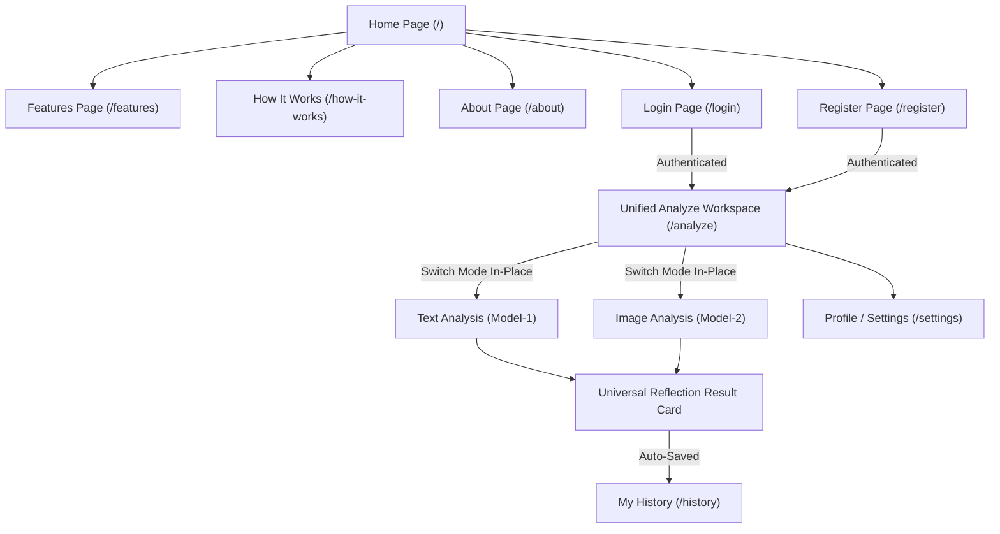

# MirrorMind AI — Website Architecture, Pages & UI Component Analysis

This document provides a comprehensive breakdown of the **MirrorMind AI** web application structure, its page-by-page routing architecture, all interactive views, protected workflows, and the exact details presented to the user across each route.

---

## Executive Overview: Dedicated Routing Architecture

In accordance with the updated product specifications, **MirrorMind AI** is engineered as a multi-page web application powered by **React Router** (`react-router-dom`). Each main section operates as an independent route with its own URL, dedicated content, and browser history, while the **Analyze** workspace remains unified on a single route (`/analyze`) with in-place mode switching between Text Analysis and Image Analysis.

---

## 1. Top Navigation Bar (`Navbar.jsx`)

The navigation bar is sticky, featuring responsive glassmorphism (`backdrop-filter: blur(12px)`), an adaptive bottom border on scroll, active route highlighting, and mobile responsiveness.

### Header Navigation Specifications:
* **Brand Logo & Mark**: Geometric SVG mark combining an abstract mirror contour with a resonant mind arc (soft pink `#F9A8D4` and sky blue `#7DD3FC`). Click navigates to Home (`/`).
* **Product Name**: `MirrorMind AI` (bold editorial typography).
* **Center Navigation**:
  * **Home** $\rightarrow$ `/` (Active route highlighting)
  * **Features** $\rightarrow$ `/features`
  * **How It Works** $\rightarrow$ `/how-it-works`
  * **About** $\rightarrow$ `/about`
  * *(When Authenticated)*:
    * **Analyze** $\rightarrow$ `/analyze`
    * **My History** $\rightarrow$ `/history`
* **Right Controls (Unauthenticated State)**:
  * `Login` link $\rightarrow$ `/login`
  * `Get Started →` button $\rightarrow$ `/login` (Directs unauthenticated visitors to login/onboarding)
* **Right Controls (Authenticated State)**:
  * **User Avatar Pill** $\rightarrow$ `/settings` (Displays user's initial and display name/email)
  * **Analyze** button $\rightarrow$ `/analyze`
  * **Sign Out** button $\rightarrow$ Signs out active Firebase Auth session
* **Mobile Drawer**: Responsive slide-down menu with active link highlighting on small screens.
* **Strict Rule**: No separate Text Analysis or Image Analysis items are present in the navigation.

---

## 2. Home Page (`HomePage.jsx` — `/`)

The welcoming landing page designed with spacious layout, editorial typography, and interactive multimodal synthesis demonstration. It provides an uncluttered overview and does not duplicate the full content of subsequent pages.

### Elements & Details Shown:
1. **Eyebrow Pill Badge**: `MULTIMODAL EMOTION INTELLIGENCE` with sparkle icon.
2. **Main Headline**:
   > *"Meet the mirror that understands more than words."*
   *(The word **understands** rendered in soft pink $\rightarrow$ sky-blue gradient text).*
3. **Interactive Multimodal Synthesis Visual (`Hero.jsx`)**:
   * Two signal cards (Text and Facial Image contour) converging into the central MirrorMind AI hub with animated dashed paths.
   * Real-time interactive pill: `Emotional Signal Detected: Joy & Pride (92%)`.
4. **The Core Concept Section (`SignalSection.jsx`)**:
   * Headline: `"Emotion isn't expressed in just one way."`
   * Two columns detailing Words (what you write) and Expressions (what your face communicates).
5. **Curated Modality Teasers**:
   * NURA Model-1 card: Highlights lexical polarity with a link to `/features`.
   * NURA Model-2 card: Highlights FER spatial pixel classification with a link to `/features`.
6. **Quick CTA Banner**:
   * High-contrast black container with button: `Launch Workspace →` (`/analyze`).

---

## 3. Features Page (`FeaturesPage.jsx` — `/features`)

A deep dive into the machine learning models and neural architectures powering MirrorMind AI.

### Elements & Details Shown:
* **Section Heading**: `"Two specialized models. One digital mirror."`
* **NURA Model-1 (Text Analysis)**:
  * Architecture: TF-IDF N-gram feature representation + Calibrated Linear Support Vector Machine (LinearSVC).
  * Taxonomy: Joy, Sadness, Anger, Fear, Love, Surprise, Neutrality.
  * Calibration: Isotonic / Platt probability scaling.
  * Latency: $< 35\text{ms}$.
  * Action: `Test Text Model →` (Navigates to `/analyze` with text mode preselected).
* **NURA Model-2 (Facial Expression Recognition)**:
  * Architecture: FER-2013 spatial pixel classifier (35,000+ faces).
  * Preprocessing: Grayscale conversion, 48x48 resize, StandardScaler pixel normalization.
  * Loss: Modified Huber loss for calibrated probabilities.
  * Accepted formats: JPG, JPEG, PNG (up to 10MB).
  * Action: `Test Image Model →` (Navigates to `/analyze` with image mode preselected).
* **Capabilities Comparison Table**:
  * Side-by-side comparison of input formats, feature spaces, probability vectors, and client storage policies.

---

## 4. How It Works Page (`HowItWorksPage.jsx` — `/how-it-works`)

An educational walkthrough detailing the technical 4-stage pipeline from signal input to calibrated reflection.

### Elements & Details Shown:
* **Section Heading**: `"How emotional signals become reflections."`
* **Stage 01: Signal Capture**: Client-side validation of text length and image file integrity.
* **Stage 02: Preprocessing**: TF-IDF tokenization for text; 48x48 grayscale pixel normalization for facial imagery.
* **Stage 03: Neural Inference**: FastAPI Python backend executing genuine serialized scikit-learn models (`best_model.joblib`).
* **Stage 04: Calibrated Reflection**: Probability distribution output normalized across all candidate emotion categories.
* **End-To-End Architecture Diagram**: Visual flow diagram illustrating data path from client to backend.
* **Primary Action**: `Try It in the Unified Workspace →` (`/analyze`).

---

## 5. About Page (`AboutPage.jsx` — `/about`)

Covers the brand philosophy, ethical AI charter, privacy principles, and creator contact information.

### Elements & Details Shown:
* **Brand Story & Philosophy**:
  * Explains why emotions are multidimensional and why MirrorMind acts as a reflective mirror rather than a diagnostic judge.
* **Responsible AI Charter**:
  * Explains that model outputs are statistical probabilities from training distributions, not psychiatric diagnoses.
  * Emphasizes the role of context and human agency.
* **Data Privacy & Security**:
  * Zero photo retention (images processed in-memory and discarded immediately; never stored in cloud buckets).
  * No background tracking or passive camera monitoring.
* **Project Creator Section**:
  * Creator: **Divya Dharshini M.**
  * Clickable contact email: `divyamallayan2007@gmail.com`.

---

## 6. Unified Analyze Page (`AnalyzePage.jsx` — `/analyze`)

The single, unified interactive workspace for multimodal emotion analysis.

### Elements & Details Shown:
* **Workspace Header**:
  * Title: `"What would you like MirrorMind to see?"`
  * Subtitle: `"Select a mode below to test genuine machine learning models for language or facial expressions."`
* **In-Place Segmented Mode Switcher**:
  * **Text Analysis (Model-1)**
  * **Image Analysis (Model-2)**
  * *Switching modes updates content dynamically within `/analyze` without changing URLs or navigating away.*
* **Text Analysis Mode (`TextAnalyzer.jsx`)**:
  * Text input textarea with live character counter.
  * Sample prompt chips for immediate testing.
  * Processing spinner: *"MirrorMind is reading between the lines..."*
  * Button: `Reflect on Text →` (Submits to `POST /api/analyze/text`).
* **Image Analysis Mode (`ImageAnalyzer.jsx`)**:
  * Drag-and-drop dropzone with file picker (`JPG`, `JPEG`, `PNG` up to 10MB).
  * High-fidelity image preview thumbnail with file size and remove button.
  * Processing spinner: *"MirrorMind is observing the expression..."*
  * Button: `Reflect on Image →` (Submits to `POST /api/analyze/image`).
* **Universal Reflection Card (`ResultCard.jsx` & `EmotionChart.jsx`)**:
  * Detected emotional signal (e.g. `Joy`, `Happy`, `Surprise`).
  * Calibrated confidence percentage badge (e.g. `100%`).
  * Horizontal probability distribution bars for all candidate classes.
  * Model attribution badge: `Linear Support Vector Machine`.
  * Actions: `Copy` reflection and `Analyze Another`.
  * Automatically syncs reflection to user history when authenticated.
* **Guest Preview Notice**:
  * If visiting unauthenticated, displays an inline prompt with a link to `/login` to save reflections.

---

## 7. Login Page (`LoginPage.jsx` — `/login`)

Dedicated authentication screen for signing into existing MirrorMind accounts.

### Elements & Details Shown:
* **Header**: `"Welcome back"`
* **Subtitle**: `"Sign in to step into your MirrorMind workspace."`
* **Form Controls**:
  * Email Address input (with Mail icon).
  * Password input with show/hide password toggle (with Lock icon).
* **Validation & Security**:
  * Authenticates against **Firebase Authentication** (`mindmirrorai-53073`) with secure local crypto fallback.
  * Inline error alerts on invalid credentials.
* **Primary Action**: `Sign In →` (Redirects to `/analyze` on success).
* **Footer Link**: `"Don't have an account? Create an account →"` (`/register`).

---

## 8. Register Page (`RegisterPage.jsx` — `/register`)

Dedicated onboarding screen for creating a new MirrorMind account.

### Elements & Details Shown:
* **Header**: `"Create your account"`
* **Subtitle**: `"Unlock multimodal emotion analysis and personal reflection history."`
* **Form Controls**:
  * Full Name input.
  * Email Address input.
  * Password input (minimum 6 characters) with show/hide toggle.
  * Confirm Password input.
* **Validation**:
  * Verifies non-empty fields, minimum character thresholds, and matching passwords.
  * Integrates with Firebase Auth `createUserWithEmailAndPassword` and `updateProfile`.
* **Primary Action**: `Create Account →` (Redirects to `/analyze` on success).
* **Footer Link**: `"Already have an account? Sign in →"` (`/login`).

---

## 9. My History Page (`HistoryPage.jsx` — `/history`)

A private timeline of emotional signals interpreted across past sessions.

### Elements & Details Shown:
* **Authentication Gate**: Prompts unauthenticated visitors to sign in (`/login`).
* **Header & Controls**:
  * Title: `"My History"`
  * Subtitle: `"A chronological record of emotional signals interpreted across your sessions."`
  * Action buttons: `New Analysis →` (`/analyze`) and `Clear All` (with confirmation).
* **Filters & Search**:
  * Modality filters: `All Signals`, `Text Only`, `Image Only`.
  * Real-time search input by emotion keyword.
* **Reflection Cards Grid**:
  * Modality badge pill (`TEXT REFLECTION` or `IMAGE REFLECTION`).
  * Detected emotion and confidence percentage badge.
  * Candidate probabilities breakdown with horizontal indicator bars.
  * Formatted date and time stamp.
  * Individual delete button per reflection.
* **Persistence**: Synchronized in real-time with **Firebase Firestore** (`users/{uid}/reflections`) and localStorage fallback.

---

## 10. Profile & Settings Page (`SettingsPage.jsx` — `/settings`)

User account management, AI model connectivity status, and data controls.

### Elements & Details Shown:
* **Profile Overview Card**:
  * User avatar badge with initial.
  * Registered display name and email address.
  * Unique account ID and authentication provider.
* **AI Model Backend Health**:
  * Real-time status for Model-1 (NURA Text - LinearSVC) at `http://localhost:8000/api/analyze/text`.
  * Real-time status for Model-2 (NURA Image - FER-2013) at `http://localhost:8000/api/analyze/image`.
  * Color-coded status badges (`● ONLINE`).
* **Data Management**:
  * `Clear Device Cache` button for local reflection storage.
* **Session Control**:
  * `Sign Out` button with active session termination.

---

## 11. Minimal Footer (`Footer.jsx`)

Consistent, minimal, and responsive across all pages.

### Elements & Details Shown:
* **Left Side**:
  * `MirrorMind AI` logo and name.
  * `"See the signal. Understand the moment."`
* **Right Side**:
  * **Divya Dharshini M.**
  * Clickable email link: `divyamallayan2007@gmail.com` with `mailto:` scheme.
* **Bottom**:
  * `© 2026 MirrorMind AI. All rights reserved.`
  * Quick navigation links: `Features`, `How It Works`, `About`, `Analyze`.

---

## Summary Matrix of Application Routes

| Route | Page Name | Primary Audience | Key Content & Interactive Features |
| :--- | :--- | :--- | :--- |
| **`/`** | **Home** | All Visitors | Hero interactive synthesis visual, core concept, curated feature teasers |
| **`/features`** | **Features** | All Visitors | Model-1 & Model-2 technical specs, capabilities comparison table, launch CTAs |
| **`/how-it-works`** | **How It Works** | All Visitors | 4-stage pipeline breakdown (Capture, Preprocess, Inference, Reflection) |
| **`/about`** | **About** | All Visitors | Brand philosophy, Responsible AI Charter, privacy policy, creator info |
| **`/analyze`** | **Analyze** | All Visitors | Unified workspace with in-place Text (Model-1) & Image (Model-2) modes |
| **`/login`** | **Login** | Visitors | Firebase Auth email/password login, redirect to `/analyze` |
| **`/register`** | **Register** | Visitors | Account creation with full name, password verification, redirect to `/analyze` |
| **`/history`** | **My History** | Authenticated | Saved reflections timeline, modality filters, search, Firestore sync |
| **`/settings`** | **Profile / Settings**| Authenticated | User identity, Model-1 & Model-2 live health status, cache clear, sign out |
